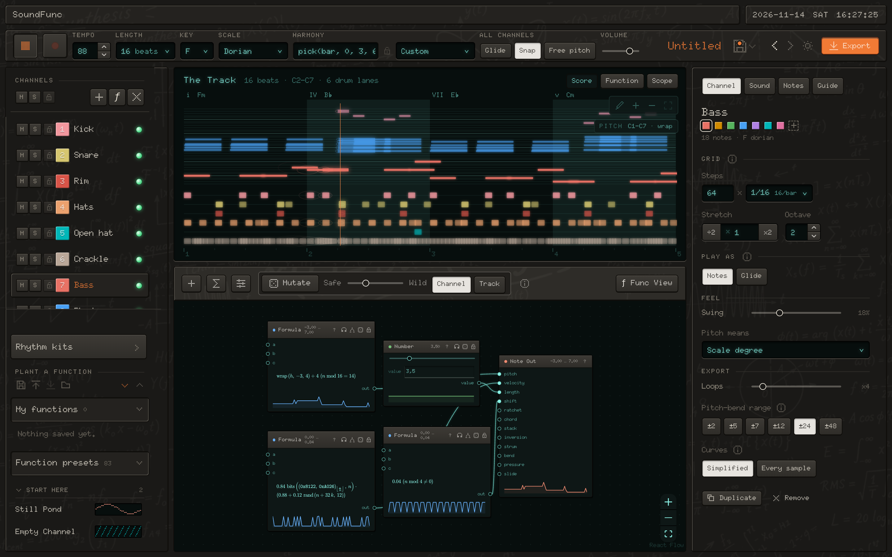
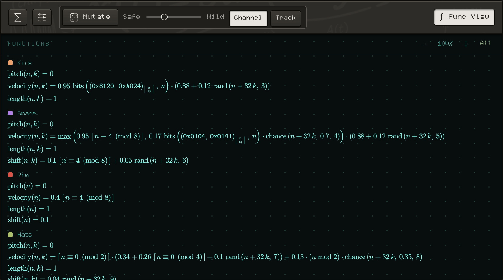

# SoundFunc

Explore making music with math, and export to midi with automations



Every channel is a function you can read back as math, typeset, while it plays:



See the [walkthrough](WALKTHROUGH.md) for a screenshot tour of every part of the app, and [USAGE.md](USAGE.md) for the full reference.

TODO: MPE support

```sh
npm install
npm run dev      # http://localhost:5173
npm test         # engine tests
npm run build
```


## Structure

```
src/engine/   framework-free core (unit-tested)
  expr.ts       safe expression parser → closures, math/music function library
  graph.ts      node definitions + graph compiler (topological, cycle-safe)
  music.ts      scales (incl. Hirajōshi, In Sen, Iwato, Yo), degree/semitone mapping
  project.ts    tracks, songs, note generation
  audio.ts      Web Audio scheduler + synth voices (bell FM, koto pluck, pad, shakuhachi…)
  midi.ts       Standard MIDI File writer (notes, GM drums, pitch-bend glides) + CSV export
  timbre.ts     formula → one-cycle waveform → Fourier harmonics
  mutate.ts     the randomizer: role-aware parameter & formula mutation + musical fitness
  symbolic.ts   graph → closed-form expression → LaTeX / SoundFunc / JavaScript / Python
  importMath.ts LaTeX / Desmos / plain math → SoundFunc expression (piecewise → velocity gate)
  graphEdit.ts  explode, collapse, blocks, audition — pure graph transforms
  blocks.ts     built-in blocks
  presets.ts    default functions
src/state/    zustand store (persisted, undo/redo)
src/components/ React UI (React Flow node editor, canvas visualizer)
```

Adding a node type is just a new entry in `NODE_DEFS` in `graph.ts`. The UI, palette and evaluator pick it up automatically.
