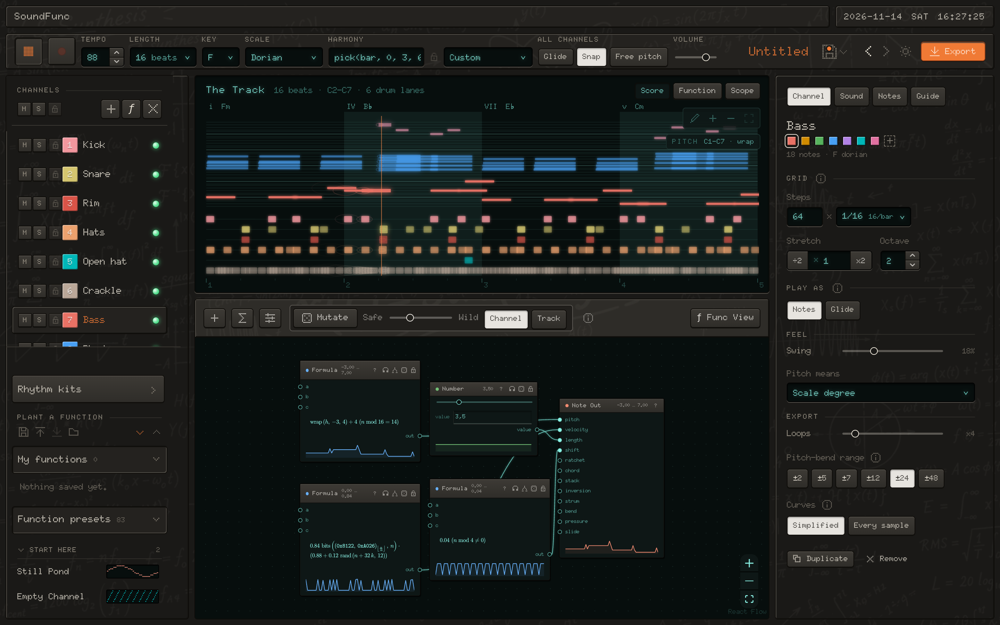
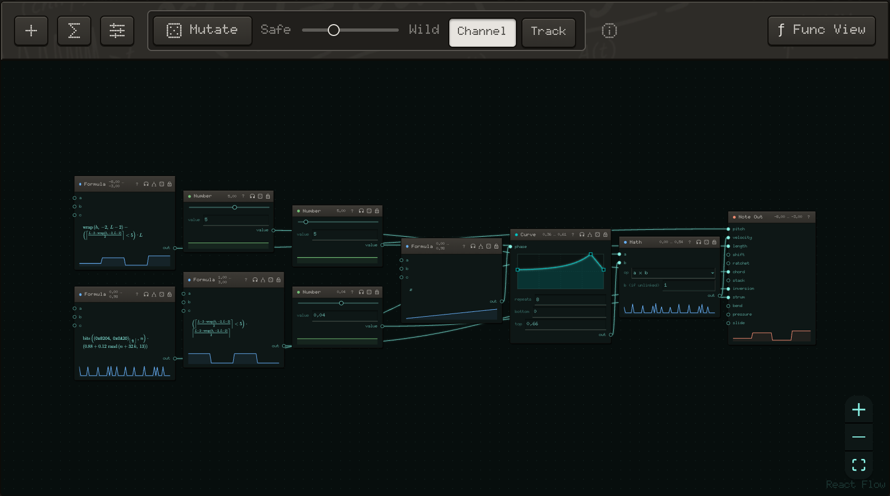
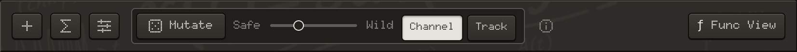
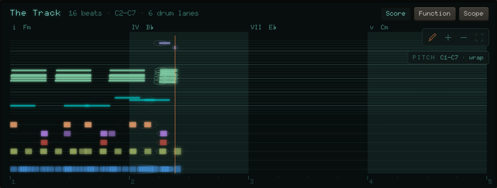
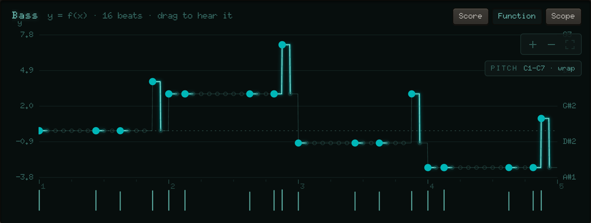
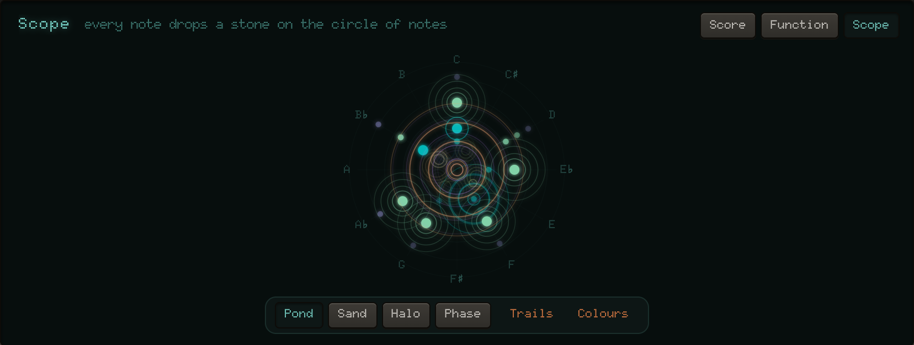
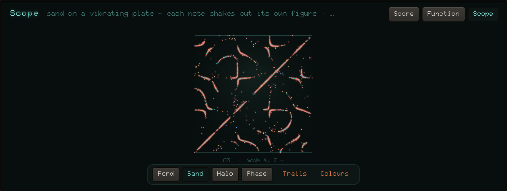
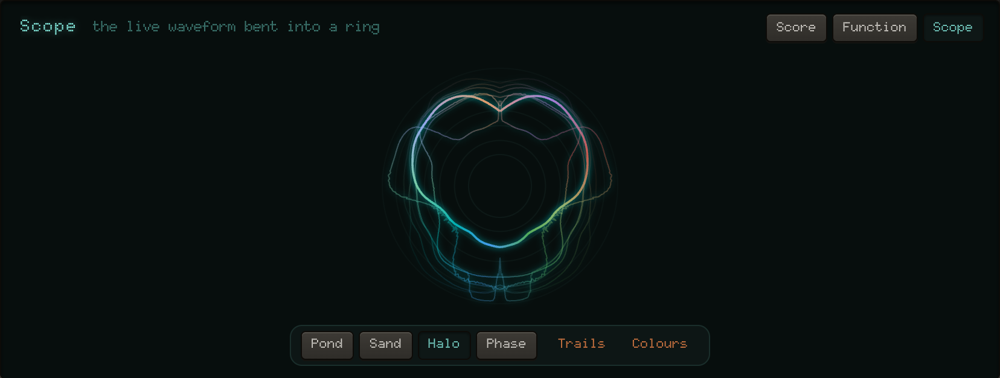
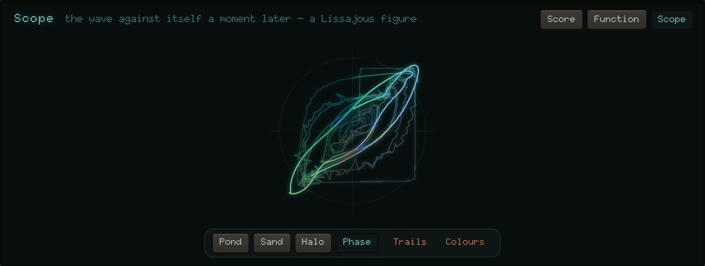
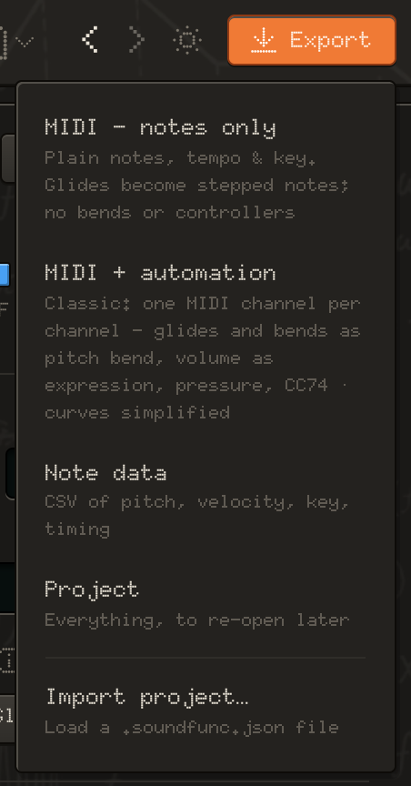

# SoundFunc walkthrough

A tour of the core of SoundFunc: you plant functions, shape them as nodes, watch and hear them as a score, read them back as math, and export MIDI. Every screenshot is the app in dark mode, playing the **Dusty Fingers** rhythm kit. [USAGE.md](USAGE.md) has the full reference.

The screen has five parts:

- **Top bar** — the whole song: play, record, tempo, length, key, scale, the harmony (a formula of `bar`), the controls that act on every channel, and Export.
- **Left** — the channels on top; rhythm kits and functions to plant below.
- **Middle, top** — the visualizer: *Score*, *Function* and *Scope*.
- **Middle, bottom** — the selected channel as a graph of nodes, or every channel written as math in **Func View**.
- **Right** — the Inspector for the selected channel: *Channel*, *Sound*, *Notes* and *Guide*.

---

## 1 · Plant something

### Rhythm kits

One finished groove per style: hip-hop, G-funk, trap and phonk, neo-soul, trip hop, deep house, bossa nova, liquid DnB and a phasing math piece. Hover a kit to see its channels. Double-click it to replace the track, or use **Layer whole kit**, **Percussion only**, or **+ Add** on single channels. Hover a kit in the list to export it.

### Function presets

83 functions in groups: sequences and fractals, melodies, chords, bass lines, G-funk parts, glide curves and risers. Each one shows a small score of what it plays. Click one to plant it as a new channel. **My functions** holds the ones you save; sort them newest or oldest first with ⌄ ⌃.

### Paste a function

Paste LaTeX straight from Desmos, plain math, `\begin{cases}` piecewise functions, or several lines with helper definitions. SoundFunc shows how it read the function and plots exactly what the channel will play. If the function's length doesn't match the song, it asks how to fit it.

### Channels

**M**ute, **S**olo and a 🔒 lock against Mutate on every channel. The LED is lit while the channel sounds. **+** adds an empty channel, **ƒ** pastes a function, **×** clears the track. The channel list keeps its own half of the sidebar, so it never scrolls out of view.

---

## 2 · Shape it as nodes

Each channel is a graph. Clocks (`n`, `x`, `t`, `k`, the chord `h`) flow through formulas, waves, curves, Euclidean rhythms and series into **Note Out**. Note Out turns its inputs into notes every step: pitch, velocity, length, shift, ratchet, chord, inversion, strum, bend and more. Every node draws its output as you edit.

**Mutate** rewrites node values and formulas, renders about 40 candidates and keeps the most musical one. The **Safe ↔ Wild** dial sets how far it may go. Mutate acts on the selected channel or on the whole track. Locked nodes and locked channels are never touched.

---

## 3 · Watch it play

### Score

Every channel at once, with drums in their own lanes. The chord of each bar is written along the top. Hover a note to see its pitch, velocity and the raw value of `f`.

Switch on the ✎ pen and the score is drawn in as the track plays. Each note grows from its start to the playhead, and the score starts fresh each loop.

### Function

`y = f(x)` for the selected channel across the whole loop. Drag across it to hear the curve.

### Scope

Four ways to watch the track:

| | |
|---|---|
| **Pond** — every note drops a stone on the circle of notes  | **Sand** — sand on a vibrating plate: each note shakes out its own Chladni figure  |
| **Halo** — the live waveform bent into a ring  | **Phase** — the wave against itself a moment later: a Lissajous figure  |

---

## 4 · Read it back as math

### Func View

The **ƒ Func View** key writes every channel you can hear as math, in the node board's place. It follows mute, solo and new channels as you go. **All** adds every Note Out input; − / + zooms. Keep the score above and the functions below for a screen recording.

### The function, in full (∑ or F)

A whole channel, or the whole track, as one closed-form function: every node inlined and shared parts named. View it as typeset math, SoundFunc formulas, or standalone JavaScript or Python that reproduce the engine's numbers exactly. Copy it, or download it as `.tex`, `.txt`, `.js` or `.py`.

---

## 5 · Shape the sound

### Channel

The selected channel's grid (steps × step length, stretch, octave), whether it plays as notes or a continuous glide, swing, what *pitch* means (scale degree, semitone or normalized), and its MIDI export settings.

### Sound

Mix, then the voice: a stock patch, one of the ten **Sonic Menagerie** voices, or your own one-cycle wave `f(p)`, drawn as you type. **Sauce** adds width and shimmer in one knob, and **Surprise me** makes a tasteful variation. The Oscillator, Filter, Amp and Effects tabs reach every setting. ‹ › step through the voices; the icons next to them mutate or lock the wave, and save, import or export voices.

---

## 6 · Take it out

**Export** writes MIDI with notes only, or with automation (glides and bends as pitch bend, volume as expression, pressure, CC74). It also writes CSV note data, or the whole project to reopen later. The ● record key beside play captures a jam as MIDI and audio.

