# SoundFunc walkthrough

A tour of the core of SoundFunc: you plant functions, shape them as nodes, watch and hear them as a score, read them back as math, bring MIDI in as functions, and export MIDI or record a jam. Every screenshot is the app in dark mode, playing the **Dusty Fingers** rhythm kit. [USAGE.md](USAGE.md) has the full reference.

The screen has five parts:

- **Top bar** — the whole song: play, record, tempo, length, key, scale, the harmony (a formula of `bar`), the controls that act on every channel, and Export.
- **Left** — the channels on top; rhythm kits and functions to plant below.
- **Middle, top** — the visualizer: *Score* and *Function*, with a backdrop of the live sound behind them.
- **Middle, bottom** — the selected channel as a graph of nodes, or every channel written as math in **Func View**.
- **Right** — the Inspector for the selected channel: *Channel*, *Sound*, *Notes* and *Guide*.

---

## 1 · Plant something

### Rhythm kits

One finished groove per style: hip-hop, G-funk, trap and phonk, neo-soul, trip hop, deep house, bossa nova, liquid DnB and a phasing math piece. Hover a kit to see its channels. Double-click it to replace the track, or use **Layer whole kit**, **Percussion only**, or **+ Add** on single channels. Hover a kit in the list to export it.

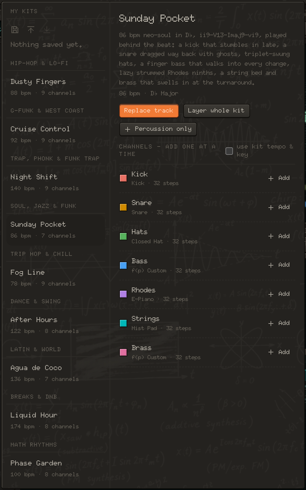

### Function presets

182 functions in groups: sequences and fractals, melodies, arps, chords, pads and cinematic chord stories, bass lines, G-funk parts, call and response, glide curves, rave, and creatures and machines. Each one shows a small score of what it plays. Click one to plant it as a new channel. **My functions** holds the ones you save; sort them newest or oldest first with ⌄ ⌃.

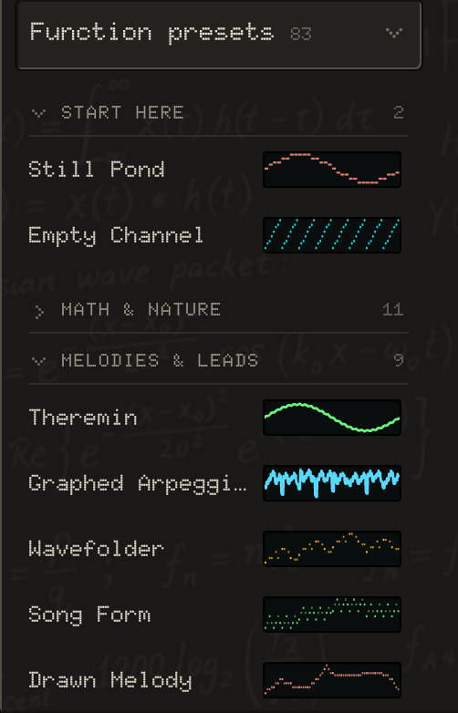

### Paste a function

Paste LaTeX straight from Desmos, plain math, `\begin{cases}` piecewise functions, or several lines with helper definitions. SoundFunc shows how it read the function and plots exactly what the channel will play. If the function is longer or shorter than the song's Length, it is cut to it or runs on to fill it; an import never changes the Length.

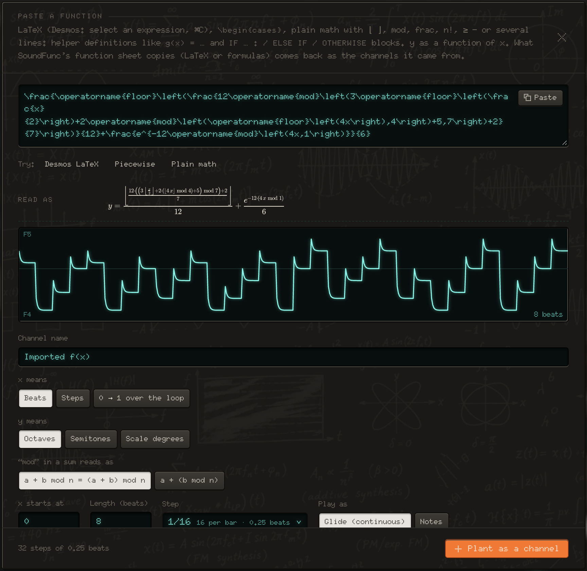

### Import MIDI

Drop a `.mid` file anywhere on the window, or use **Export → Import MIDI…**. Every part of the file becomes a channel of functions.

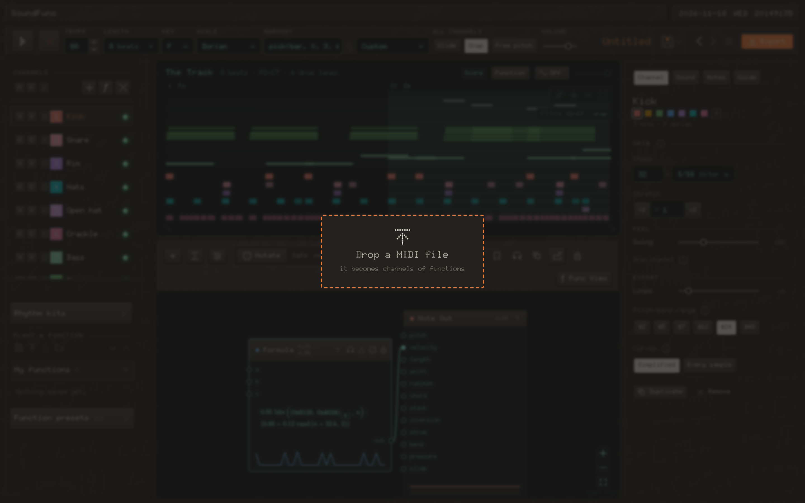

The sheet opens on an overview of the whole file and works nothing out until you choose the stretch to bring in. Drag across the overview; the ends snap to bars, beats, 1/8, 1/16, or the notes' own starts, so a part that begins on a pickup comes in from where it begins. Zoom in with − / + to pick bars in a long song.

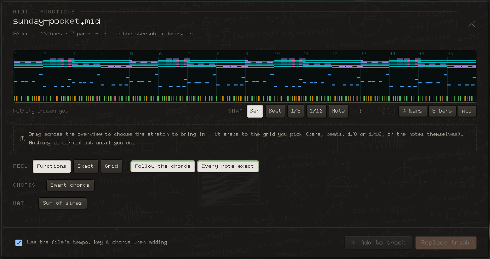

Once you choose, it finds each part's grid and swing, the key, and the chord of every bar, and writes each part as compact formulas: rhythms as `every()`, `euclid()` or `bits()` masks, pitches against the chord. The options on the sheet choose how:

- **Feel:** *Functions* models the feel (accents, ghost notes as `chance()`, a measured `rand()` for the hand). *Exact* keeps every note as played. *Grid* puts everything on the grid.
- **Smart chords** keeps chord parts as one chord channel even with doublings, added tones or notes outside the key.

Tick the channels you want, then **Replace track** or **Add to track**. Your song's Length never changes: the channels fit into it.

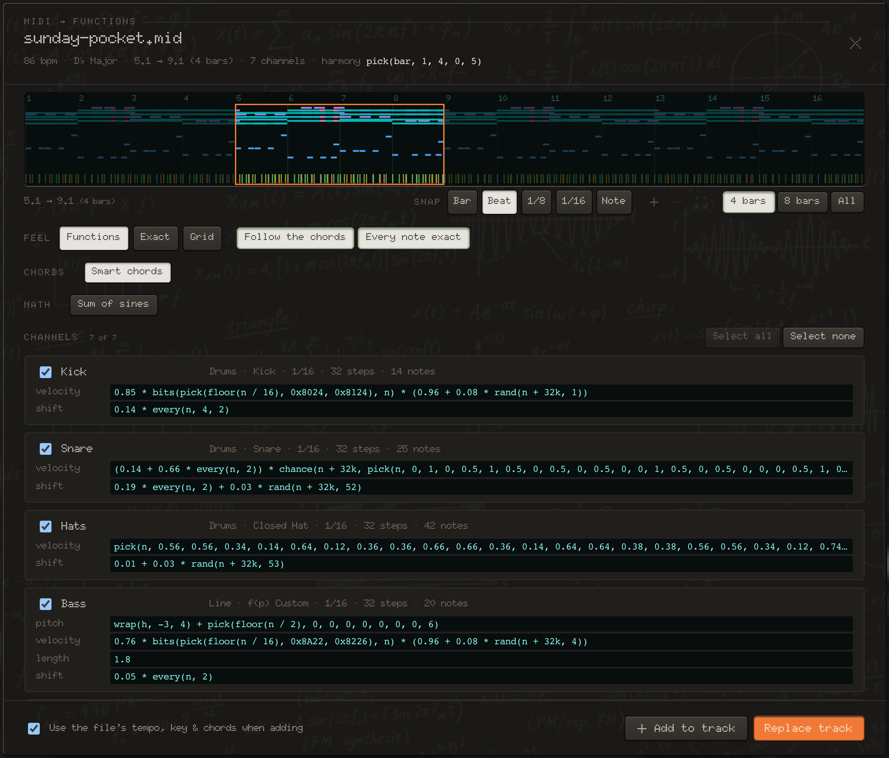

With **Sum of sines** under *Math*, a line's pitch becomes a pure function: a few sines over the loop that land every note. *Glide line* plays it as one voice sliding along the curve.

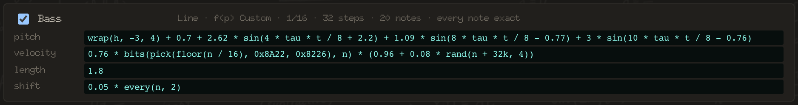

### Channels

**M**ute, **S**olo and a 🔒 lock against Mutate on every channel. The LED is lit while the channel sounds. **+** adds an empty channel, **ƒ** pastes a function, **×** clears the track. The channel list keeps its own half of the sidebar, so it never scrolls out of view.

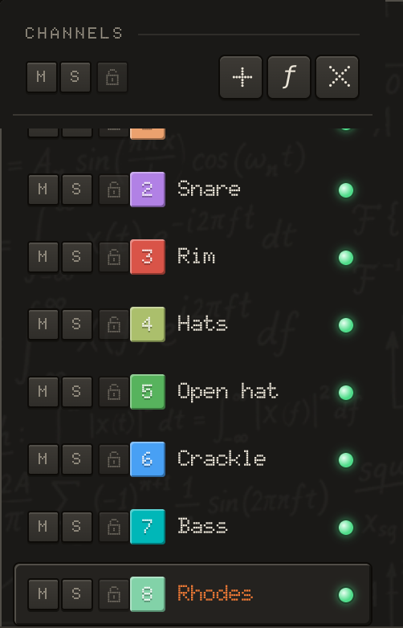

---

## 2 · Shape it as nodes

Each channel is a graph. Clocks (`n`, `x`, `t`, `k`, the chord `h`) flow through formulas, waves, curves, Euclidean rhythms and series into **Note Out**. Note Out turns its inputs into notes every step: pitch, velocity, length, shift, ratchet, chord, inversion, strum, bend and more. Every node draws its output as you edit.

**Mutate** rewrites node values and formulas, renders about 40 candidates and keeps the most musical one. The **Safe ↔ Wild** dial sets how far it may go. Mutate acts on the selected channel or on the whole track. Locked nodes and locked channels are never touched.

---

## 3 · Watch it play

### Score

Every channel at once, with drums in their own lanes. The chord of each bar is written along the top. Hover a note to see its pitch, velocity and the raw value of `f`.

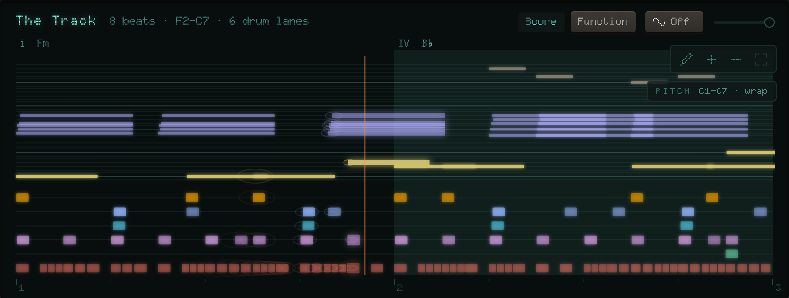

Switch on the ✎ pen and the score is drawn in as the track plays. Each note grows from its start to the playhead, and the score starts fresh each loop.

### Function

`y = f(x)` for the selected channel across the whole loop. Drag across it to hear the curve.

### Backdrop

The 〰 key beside *Score* and *Function* puts the live sound behind either view, as a dot matrix like the calculator's display: **Halo**, the waveform bent into a ring that fills the view, or **Phase**, the wave against itself a moment later, a Lissajous figure. Click it again for the next one, or Off. The slider beside it sets how strongly it shows; at most it stays faint enough for the notes to read first.

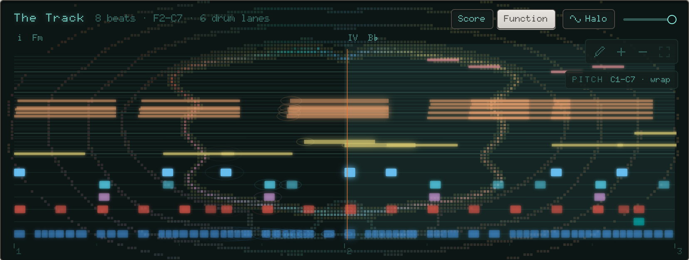

---

## 4 · Read it back as math

### Func View

The **ƒ Func View** key writes every channel you can hear as math, in the node board's place. It follows mute, solo and new channels as you go. **All** adds every Note Out input; − / + zooms. Keep the score above and the functions below for a screen recording.

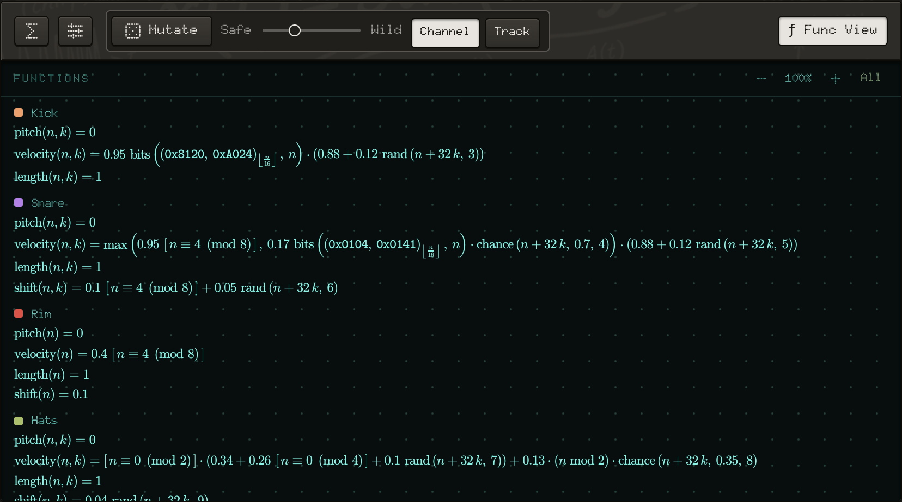

### The function, in full (∑ or F)

A whole channel, or the whole track, as one closed-form function: every node inlined and shared parts named. View it as typeset math, SoundFunc formulas, or standalone JavaScript or Python that reproduce the engine's numbers exactly. Copy it, or download it as `.tex`, `.txt`, `.js` or `.py`.

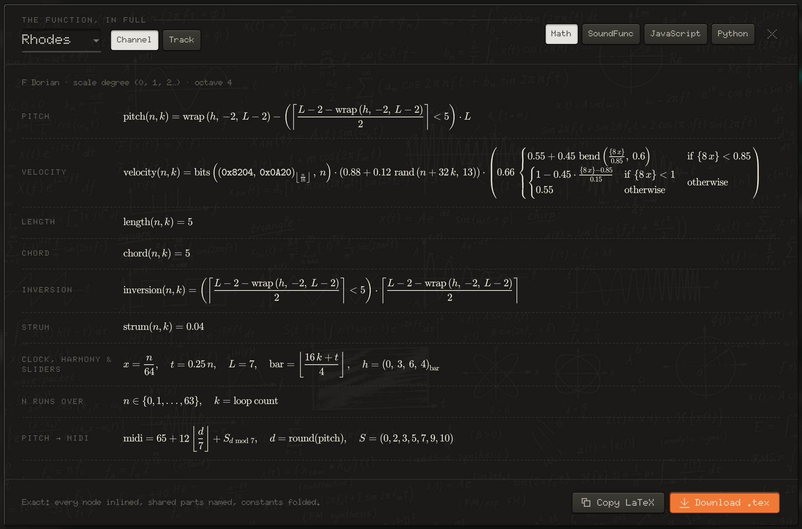

---

## 5 · Shape the sound

### Channel

The selected channel's grid (steps × step length, stretch, octave), whether it plays as notes or a continuous glide, swing, what *pitch* means (scale degree, semitone or normalized), and its MIDI export settings.

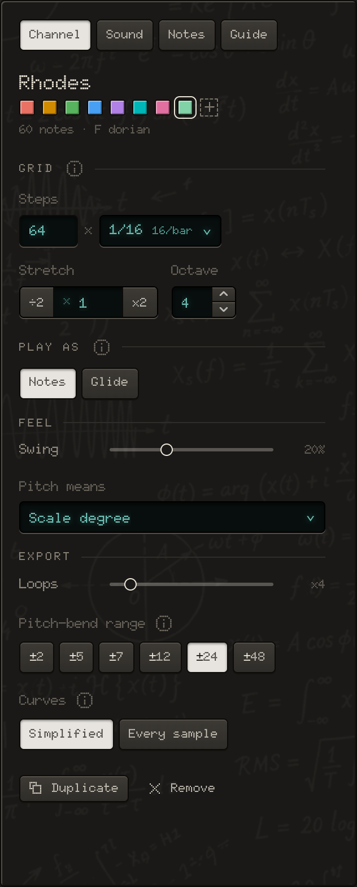

### Sound

Mix, then the voice: a stock patch, one of the ten **Sonic Menagerie** voices, or your own one-cycle wave `f(p)`, drawn as you type. **Sauce** adds width and shimmer in one knob, and **Surprise me** makes a tasteful variation. The Oscillator, Filter, Amp and Effects tabs reach every setting. ‹ › step through the voices; the icons next to them mutate or lock the wave, and save, import or export voices.

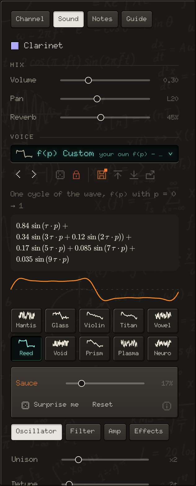

---

## 6 · Take it out

**Export** writes MIDI with notes only, or with automation (glides and bends as pitch bend, volume as expression, pressure, CC74). It also writes CSV note data, or the whole project to reopen later.

### Jam

The ● key beside play (or **J**) records a jam: everything you play and change, every channel, starting on the next bar. Mutate, mute and solo, change the tempo or the harmony while it runs; it is all in the take. The clock beside the key counts while it records. Press it again and the take ends on the next bar.

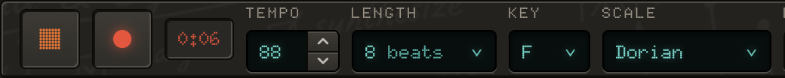

The finished take shows its length, bars, channels and tempos. Export it as **Audio** (WAV), **MIDI**, or **MIDI + automation**, or all three at once with **Export all**. Every file starts on bar 1, ready to drop into a DAW.

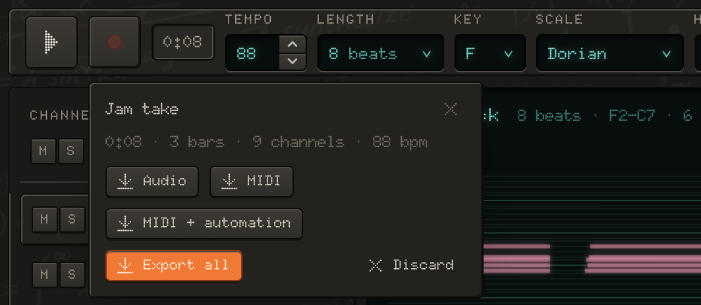
